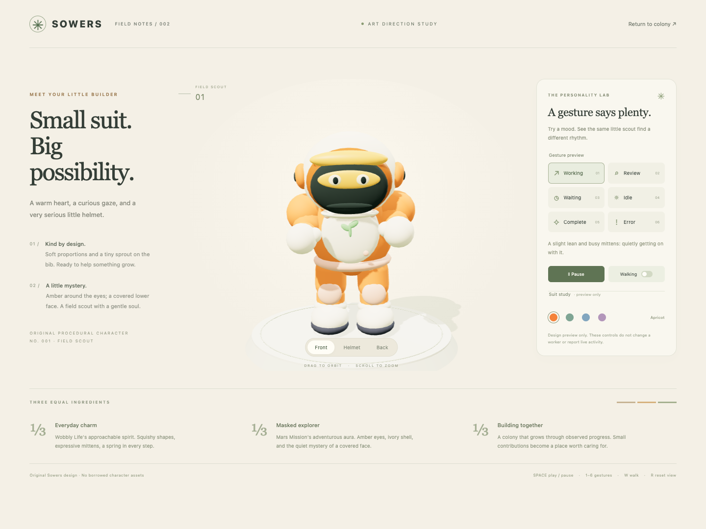

# Sowers

An original Mars outpost for watching coding agents work. A separate `codex/sowers` branch in Bot Crossing's repository; the existing colony and animation pages remain available.



The direction gives equal weight to three ingredients: Wobbly Life's soft, physical charm; the masked Mars Mission explorer's quiet readiness; and modular mission hardware that grows from reported work. All runtime meshes are original procedural geometry. No LEGO or Wobbly Life assets are runtime dependencies.

## Open it

Requires Node 22.13 or newer. From this checkout:

```sh
npm ci
npm run build
npm run sowers
```

- Mission watch: <http://127.0.0.1:5286/sowers/>
- Fixed fictional preview: <http://127.0.0.1:5286/sowers/?preview=1>
- Character studio: <http://127.0.0.1:5286/sowers/studio/>
- Base assembly study: <http://127.0.0.1:5286/sowers/assembly/>
- Broadcast composition: append `&broadcast=1` to preview or `?broadcast=1` to live.

For development, `BOT_CROSSING_INCLUDE_SUBAGENTS=1 PORT=5286 npm run dev -- --host 127.0.0.1`. On Windows use `npm run sowers` after building; the launcher sets its defaults without shell-specific environment syntax. A different `PORT` can be supplied if 5286 is occupied.

## Watch the work

Local agents come from the existing read-only session adapters. The default scope shows active work and the last 72 hours; search, Working now and All sessions narrow or expand that list. Nine Sowers occupy the current page. Selecting a Sower focuses its station; drag/scroll controls the camera. Follow, orbit, pause and a clean broadcast composition are available. On narrow screens one selected station is framed at a time. The character studio is a separate, explicitly fictional pose study, with keyboard controls and reduced-motion support.

Session records own running/error state. Explicit construction fractions or a declared plan denominator can assemble the main structure. Without those measures its completion remains **unmeasured**. Accepted checkpoints earn auxiliary hardware; retractions remove it, duplicate explicit IDs award once, and conflicting records award nothing. Time, token usage, transcript size, model output volume and idle animation never prove completion. Up to twelve checkpoint structures are shown per station; the actual count remains visible.

An optional, explicitly configured **local broadcast snapshot** can enrich matching session IDs with measured progress and checkpoints, or supply independently observed workers. The viewer does not automatically connect to a native Codex broadcast service. See [broadcast schema and configuration](docs/sowers/broadcast.md). Source notes expose warnings and freshness; stale broadcasts cannot make a fresh native worker idle.

Nothing in Sowers starts an agent, resumes research, writes to session files or mutates the Swarm protocol. Its pages use GET observation routes. Browser controls affect the local presentation only.

## Reference recovery

[Research and precise source links](docs/sowers/research.md) recover the Waypoint concept books, retired visor-up studies and the genuine `references/mars-mission` archive on older branches. The masked mm002 astronaut is historically linked in those notes and an accessible retail photo corroborates its visual design. An isolated photograph of that figure was not located in the user's GitHub. The original generated Waypoint designs are related history, not the Sowers production specification.

## Verification and work record

```sh
npm test
npm run build
```

The optional [browser verification script](tools/verify-sowers-browser.cjs) uses Playwright from a local installation, without adding a product runtime dependency. Set `SOWERS_PLAYWRIGHT_MODULE` to its package directory and optionally `SOWERS_CHROME` to an installed Chrome executable, then run `node tools/verify-sowers-browser.cjs` with the dev server on port 5286. It covers source merging, checkpoints, search/pagination, broadcast/Escape, a mode-switch race, text escaping, mobile overflow, studio reduced motion and WebGL fallback. Screenshots remain in ignored `.cache/sowers-browser/`.

[MAGI assignments, reviews and accepted findings](docs/sowers/MAGI.md) retain the actual agent handles, evidence, repaired defects and limitations. The app performs no model calls, so watching it does not consume model allowance.

Final validation: 110 tests passed; thirteen production browser scenarios passed without page errors; dependency audit clean. [Handoff and remaining limitations](docs/sowers/HANDOFF.md).
