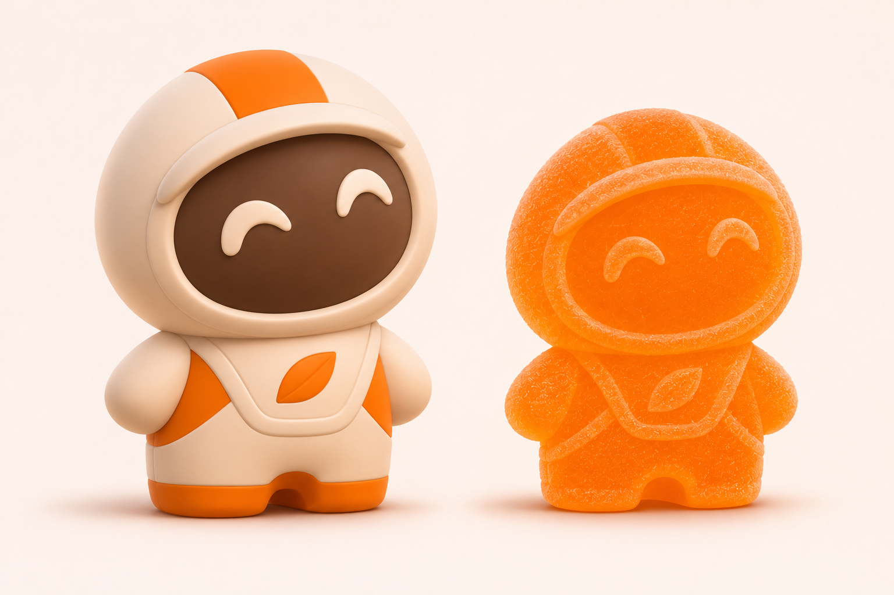

# Iteration 10 — Bot-led Sower concept

**Art-direction recipe:** M15 / W15 / B70. Percentages are authored influence weights, not measured attribution.



## Direction

A near-round protective hood and oversized cocoa face window lead over a compact, short-limbed body. The warm cream/orange/cocoa family, orange crown stripe, pale arched eyes, seed chest mark and modest orange boot treatment keep this inside the Sowers preference direction. The single orange candy concept repeats the broad hood, face, seed and connected mitten/boot silhouette as shallow relief.

## Generation record

- **Tool mode:** Built-in `image_gen.imagegen`; no CLI or paid API path.
- **Input reference:** Goat 4 only, used as the palette and helpful-personality preference anchor. Goat 2, Goat 3 and the Mars image were inspected but not included as generation references.
- **Exact prompt:**

```text
Use case: stylized-concept
Asset type: one clean character-and-candy product concept sheet for an original Sowers collectible character
Primary request: Design one original Bot-leading Sower called Scout, with recipe M15 W15 B70 (authored art-direction recipe, not a measurement). Show the full character at left and its paired single-piece orange candy interpretation at right, on one uncluttered sheet.
Input image: Image 1 is Goat 4, used only as the separate preferred cream/orange/cocoa palette and kind helper personality reference; do not copy its squircle helmet, exact construction, or exact eye graphics.
Scene/backdrop: warm cream studio backdrop with subtle grounded shadows; no extra props.
Subject: On the left, one full-body, three-quarter-front original Sower helper. Make a near-round protective hood, clearly rounder and more spherical than Goat 4's rounded-square head. The cocoa face window should be larger and rounder than Goat 4's window, framed by a small protective brow. Keep the body compact and tiny, with short attached mitten arms and short broad boots. Give the figure a kind, helpful expression and slight friendly head tilt. Use a broad orange crown stripe and modest orange boot accents, cream as the main shell/body color, cocoa only for face, pale cream arched eyes, and one original orange seed chest mark.
On the right, a single orange candy piece depicting this same character, front three-quarter view, with hood, large broad face, seed chest mark, connected short mitten arms, and boot arch integrated into one continuous rounded candy silhouette. Use broad, shallow relief only, no fine detail. Make it clearly one solid piece, not assembled parts.
Style/medium: polished high-end soft 3D collectible concept render, soft matte character surfaces; candy has restrained translucent orange confection sheen.
Composition/framing: landscape product concept sheet, full figures visible and comfortably spaced, character left, candy right, similar scale, clean studio presentation.
Lighting/mood: soft diffused studio lighting, warm, gentle and welcoming.
Color palette: warm cream, bright citrus orange, cocoa brown and pale cream eyes; candy uniformly orange.
Materials/textures: smooth softly rounded forms, sparse broad seams only; subtle candy translucency.
Text (verbatim): none.
Constraints: one character and exactly one paired candy piece; no labels, no typography, no logos, no watermark. Preserve original Sowers seed identity. The character should read as a collectible original helper.
Avoid: thin antenna, crown stalk, fragile nub, any separate accessories, separate candy pieces, disjointed hands, excessive seams, microdetail, copied Bot Crossing mesh, copied Bot Crossing face graphics, Mars insignia, Wobbly mesh or anatomy, companion/second character. If a crown crest is needed, make it a thick flush tiny seed nub; omission is preferred.
```

## Output critique

The round hood has a strong silhouette distinction from Goat 4's rounded-square shell, and the short body, broad face window and connected candy limbs follow the requested Bot-led translation. Palette and seed identity are clear. The character is more front-biased than a strong three-quarter pose and its head tilt is restrained; the broad arched-eye language is a deliberate carryover from the Goat 4 preference anchor. The candy rendering is a visual concept only, not manufacturing evidence.
