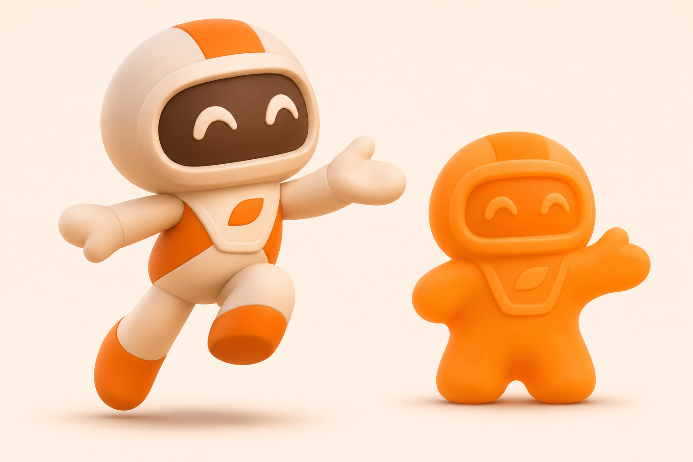

# Iteration 10 — Wobbly-led Sower prototype

## Recipe

**M15 / W70 / B15** (Mars Mission / Wobbly Life / Bot Crossing). These are authored art-direction weights, not measured attribution. The Wobbly-led direction carries the buoyant hop, rounded mobile silhouette, and open gesture. Mars contributes a shallow protective brow; Bot Crossing contributes a simple helpful display. The separate Goat 4 preference anchor supplies the cream, orange, cocoa palette and friendly arch eyes.

## Read of the sheet

The character has a large soft hood, simple cocoa face window, pale arch eyes, orange crown stripe and side panels, original seed-shaped chest mark, and orange boot ends. Narrow shoulders and a small torso keep the thick rounded limbs prominent. One leg bends into a readable hop while the arms open into a welcoming reach. The geometric masses remain distinct and attached rather than gathering into a single irregular blob.

The candy concept is a single connected orange figure. The reaching arm flows from the body through a broad connection; the legs join at a shallow rounded notch. Hood, face window, eyes, bib and seed are expressed in broad relief. It intentionally compresses the hop into a stable frontal gesture while retaining the head and seed identity.

## Critique and limits

The pair is immediately readable against a warm cream studio background and contains no text or logos. The cream/orange/cocoa character palette is preserved; the candy uses orange throughout as requested. The pose is distinct from the compact upright Goat 4 anchor, and the candy does not depend on thin limbs, separate hands, or an antenna. The generated sheet looks like a concept rendering; it does not establish candy tooling, tolerances, materials, or manufacturability.

## Generation record

- Tool mode: built-in `image_gen.imagegen` (imagegen skill); generated once, no paid CLI/API.
- References: `/Users/martinburstein/Downloads/goat.png`, `/Users/martinburstein/Downloads/goat3.png`, `/Users/martinburstein/Downloads/goat4.png`, and `.cache/sowers-reference-corpus/goat2-inspection.png`. Used for broad visual cues only; no exact character, mesh, logo, or facial art copied.
- Generated source: `private-generation-source (deliverable SHA-256 recorded)`
- Output: 1536 × 1024 PNG.
- SHA-256: `a94a9ef8bc40304adea253713898296146035a28f8892580854268a0239961f2`
- Exact prompt: see [iteration-10-wobbly-led.json](iteration-10-wobbly-led.json).
