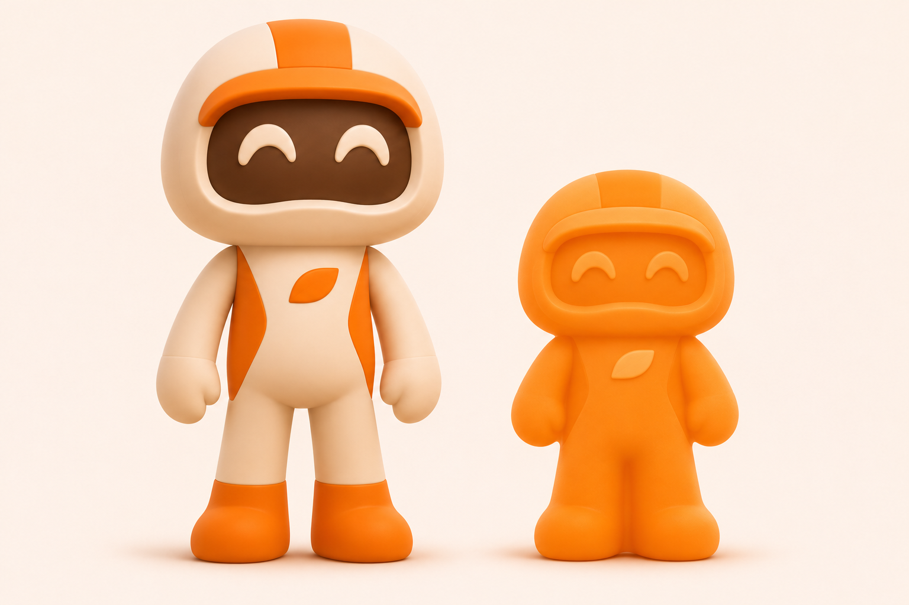

# Iteration 11 — M45/W45 protective scout baseline

## Recipe and intent

**M45 / W45 / B10** (Mars Mission / Wobbly Life / Bot Crossing) is an authored art-direction recipe, not a measurement or style attribution. The separate Goat 4 preference anchor supplies the warm cream/orange/cocoa palette, broad pale arch eyes, crown stripe, single seed chest mark, and friendly personality.

This is a neutral upright baseline: both feet planted, arms relaxed beside the torso with small gaps. Its broad enclosing protective hood, shallow projecting orange brow, and curved lower-mask edge bring in the Mars direction. Smooth substantial limbs and a visible tapered torso bring in Wobbly’s simple rounded body language without reusing the iteration-10 hop/reach pose. Bot Crossing remains a low-weight friendly helper cue.

## Full-sheet read and critique

The full three-quarter-front figure stands at the left, paired with one connected orange candy study on the right. The character’s shoulders are narrower than its hood; its torso is more visible than Goat 4’s compact body; and the thicker, longer limbs are visible in the still pose. A single orange seed/leaf mark sits on the plain cream torso. The orange flank accents are broad and prominent, but there are no straps, pockets, circular tools, or nested panels.

The candy is smooth, orange, spark-free and non-translucent, with a connected mitten-web silhouette and broad shallow relief. Its lower body compresses into a squat mass: the head-to-torso proportions and long-leg distinction are weaker than on the character. This is a visible shortcoming of the generated sheet, not a manufacturing result. No physical-scale, relief-readability, tooling, material, tolerance, or manufacturability claims are established.

## Generation record

- Tool mode: built-in `image_gen__imagegen`, one raster generation using the imagegen skill; no CLI or API.
- Generation inputs: `goat3.png`, `goat4.png`, decoded `goat2-inspection.png`, and iteration-10 Wobbly-led sheet. `goat.png` and iteration-10 Mars-led sheet were inspected for context but not passed to the generator. All references supply broad cues or comparison only; source branding and exact designs are not reproduced.
- Generated source: `private-generation-source (deliverable SHA-256 recorded)`
- Output: 1536 × 1024 PNG, SHA-256 `9363ea89dc85360b857a01af313e25e639bf426a7534488ab79871a801c110fb`.
- Exact prompt and per-reference roles: [iteration-11-mw.json](iteration-11-mw.json).
