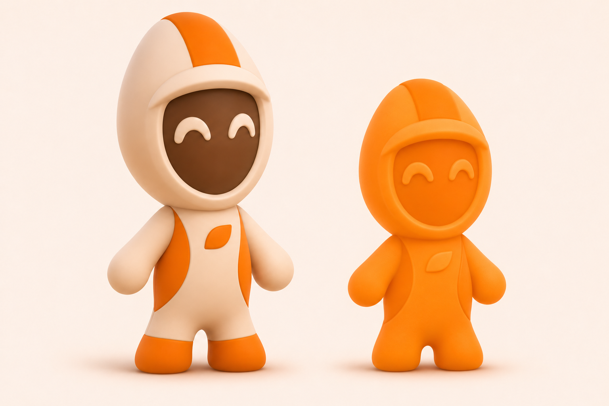

# Iteration 11 — Wobbly/Bot mixed seed-pod Sower

## Recipe

**M10 / W45 / B45** (Mars Mission / Wobbly Life / Bot Crossing). These are authored art-direction weights, not measured attribution. Broad rounded masses and friendly clarity lead, with a restrained protective brow and helpful face. Goat 4 remains a separate palette and personality preference anchor.

## Read of the sheet

The standing three-quarter-front character has a tall, vertically oval seed-pod hood narrowing toward its lower face. A distinct torso tapers below it. Medium-length thick mitten arms hang slightly away from the body, and broad feet sit planted around a shallow center notch. The cocoa face window is tall and narrow, with broad pale arch eyes. A crown stripe and one original orange seed chestmark preserve Sowers family cues.

The single orange candy repeats the vertical hood, narrowing torso, connected thick arms and broad feet with a shallow notch. Face, brow, stripe and seed are broad relief. Its surface is smooth and matte without sugar sparkle or distracting translucency.

## Critique and limits

The silhouette differs clearly from the near-round Bot-led head and airborne Wobbly-led iteration 10. The neutral stance helps isolate proportion changes from pose. The three-quarter angle remains mild and close to frontal. Broad orange torso-side accents can read as suit inserts; removing or narrowing them would make the body more uninterrupted. Candy arms and feet appear connected, with no visible thin bridges, though the render cannot establish manufacturability or exact form correspondence.

## Generation record

- Tool mode: built-in image_gen.imagegen, via the imagegen skill; no CLI or paid API.
- Recipe: M10/W45/B45, authored direction weights.
- References inspected: goat.png, goat3.png, goat4.png, decoded goat2-inspection.png, iteration-10-wobbly-led.png and iteration-10-bot-led.png.
- Generation inputs: iteration-10-wobbly-led.png (Image 1; continuity and prior silhouette/pose to move beyond) and goat4.png (Image 2; palette, eyes, crown stripe and seed preference cues).
- Generated source: private-generation-source (deliverable SHA-256 recorded)
- Output: /Users/martinburstein/Documents/ChatGPT/Sowers/public/sowers/prototypes/iteration-11-wb.png (1536 × 1024 PNG).
- SHA-256: e61c9d4f7cee66605b4e30ff472bb3d001d56b1940a064619110a112f5babe3e
- Exact prompt and full provenance: iteration-11-wb.json.
