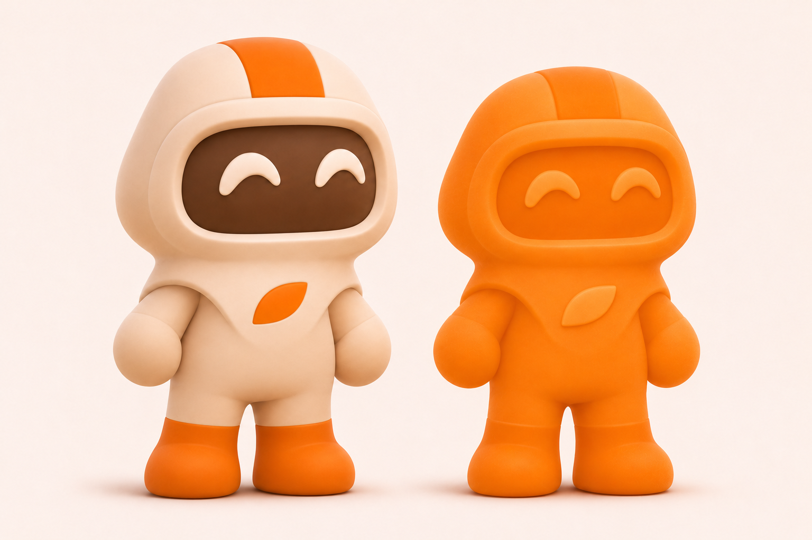

# Iteration 12 — Balanced seed-pod helper

**M34 / W33 / B33** is an authored art-direction recipe, not a measurement or style attribution. Goat 4 remains the separate preference anchor.

## Direction

This sheet combines a protective hood that tapers toward the shoulders, moderately stout rounded limbs, and a broad friendly cocoa face window with pale arch eyes. The crown stripe and one original seed chest mark carry the Sowers cues. A visible helper torso and sturdy boots keep the proportions legible.

The single orange candy follows the same overall hood-to-torso-to-leg ratio, with broad shallow relief and attached mittens. It does not collapse into the squat shape noted in the iteration 11 MW candy.

## Shape and pose review

The neutral planted stance makes the torso and legs easy to judge. The view is close to frontal, so the requested three-quarter angle and slight counterlean are weak. The hood eases into the shoulders with a gentle seed-pod taper and less flare than the compact MB cowl, though it still spreads broadly. The mitten ends are round and oversized relative to the moderate mitten target.

The candy matches the character's overall height and torso ratio well. Its lower body merges more than the colored character's, making the legs less distinct. Relief is broad and sparse; the candy remains a smooth, opaque orange without visible sugar sparkle, holes, or separate parts.

## Generation record

- Tool mode: built-in `image_gen__imagegen`, one original raster generation; imagegen skill workflow, no CLI or paid API.
- Recipe: M34/W33/B33, authored art-direction weights.
- References inspected: Goat 4, iteration 11 MB, MW, and WB. Inputs supplied to generation: Goat 4, iteration 11 MB, and iteration 11 MW. Iteration 11 WB was inspected only.
- Generated source: private project cache at `.cache/sowers-prototypes/iteration-12-balanced-source.png`; no provider or native image identifier is included in this record.
- Output: [iteration-12-balanced.png](../../../public/sowers/prototypes/iteration-12-balanced.png), 1536 × 1024 PNG.
- SHA-256: `f6eb5d63bbba7b50c8bc49647e438f9a1a52d1a9a8bad29c9c1cb42c3b70c6b3`.
- The exact tool prompt, image roles and output metadata are in [iteration-12-balanced.json](iteration-12-balanced.json).

This is exploratory concept art. It does not establish physical dimensions, candy legibility, material behavior, tooling, tolerances, or manufacturability.
