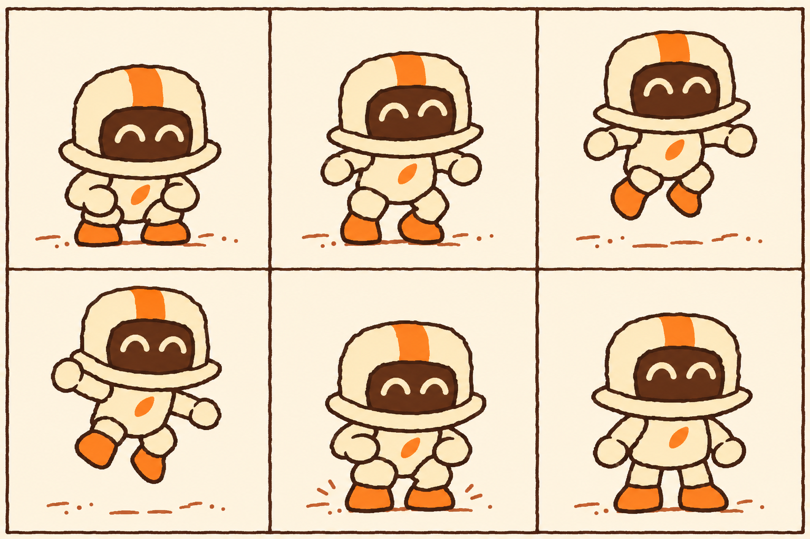

# Iteration 12 — Hop storyboard

## Design proposal

An M15 / W70 / B15 Sower is shown through six proposed hop poses, in reading order across a 2 × 3 sheet. This is a pose-design proposal only. It is not an observed source animation, validated character rig, or executable timing sequence.

The character carries the same broad cream hood and pale rim, orange crown stripe and boots, cocoa face window, two pale arch eyes, single orange chest seed, compact cream torso, and attached thick limbs through the sequence. Head and body volumes stay rigid. The sheet uses chunky dark-brown outlines, flat fills, warm cream paper, and minimal rust soil strokes and dots.

## Frame notes

1. Ready stance: planted boots and gently poised arms; reads more upright than a deep crouch.
2. Push-off: bent legs begin extending as the body lifts.
3. Ascending hop: both boots clear the soil; limbs trail slightly.
4. Apex: airborne with a small asymmetric arm and boot follow-through.
5. Landing: boots meet the ground with both legs bent and short impact marks.
6. Settled stance: relaxed, friendly upright pose with arms lowered.

## Review and limits

The sheet contains six bordered panels, one Sower per panel, and no captions or logos. Pose progression is legible, and the hood stripe, face window, arch eyes, chest seed, body palette, and boots remain consistent. The broad visor/rim is slightly oversized in places, and the first pose does not strongly communicate a crouch. The hand-drawn treatment is loose and painterly rather than literal MS Paint; outlines are chunky and flat-color construction is retained, with softly textured cream paper. No source animation, timing, joint behavior, manufacturing properties, or final character proportions are established.

## Generation record

- Tool: built-in `image_gen.imagegen`, default imagegen skill mode; one generation call; no paid CLI/API.
- Generated image ID: `01a21722-d869-7510-81b9-e013e63b55b1`.
- Reference roles: `/Users/martinburstein/Downloads/goat4.png` (preference anchor, palette and face/hood cues) and `public/sowers/prototypes/iteration-10-wobbly-led.png` (same character direction and proportions) were inspected directly. Neither was supplied as an image input to the generation call; there was no direct image-copy/edit operation.
- Private source: `.cache/sowers-generation/01a21722-d869-7510-81b9-e013e63b55b1/source.png` (same generated PNG, retained outside public/docs).
- Public deliverable: `public/sowers/prototypes/iteration-12-hop-storyboard.png`.
- Dimensions: 1536 × 1024 px, RGB PNG.
- SHA-256: `193fa1171dfae068329d3a7e31d258c04f7769765ce2d8bd88c9c3263df44faf`.
- Exact prompt and machine-readable frame descriptions: [iteration-12-hop-storyboard.json](iteration-12-hop-storyboard.json).
