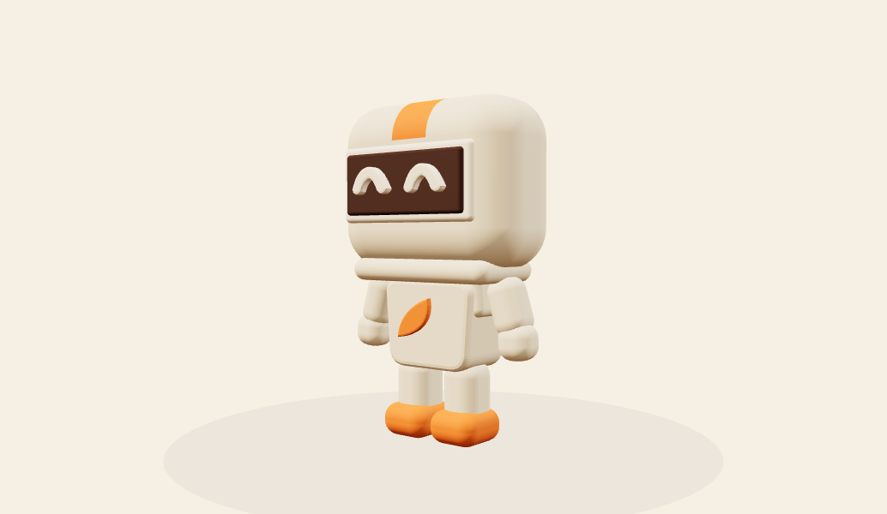
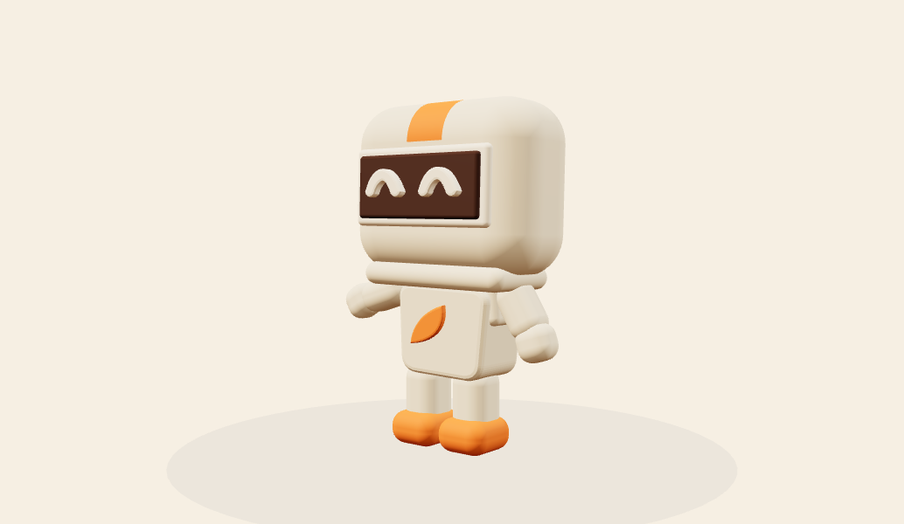
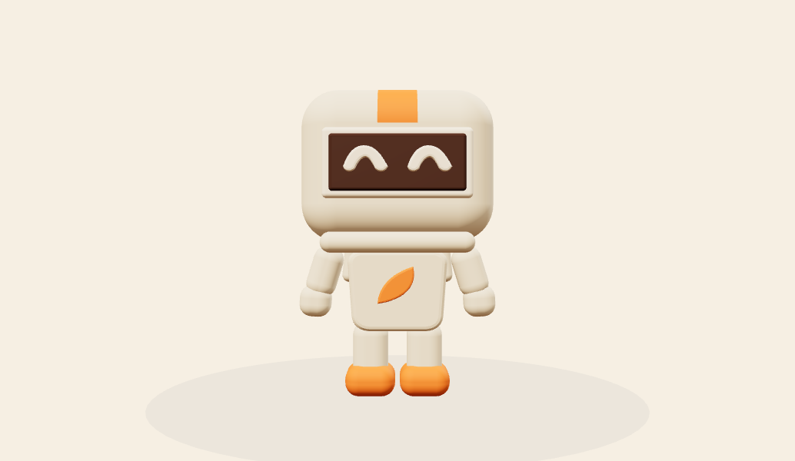
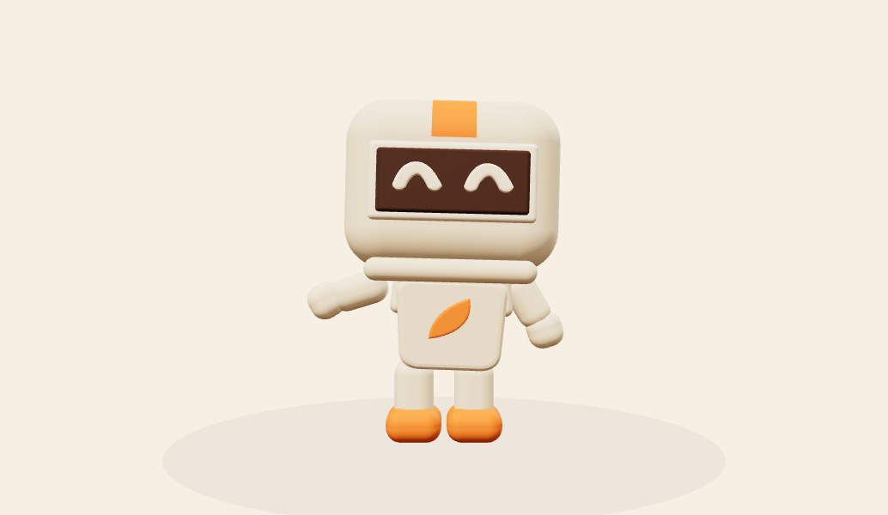

# Iteration 13 — Original 3D mascot blockout

**Scope:** isolated prototype geometry for comparing one character through neutral, reach, and hop poses. This is an art-direction blockout, not a canonical avatar change.

## Revised proportions

The hood is a broad softly rounded squircle (2.05 × 1.62, about 1.27:1) and forms about half of the overall figure height. It carries a cocoa face window, two pale arch eyes, and a crown stripe that follows the hood's curved front. The short, tapered torso carries one small raised seed mark. The upper legs now overlap the torso, and each lower leg overlaps one rounded orange boot; the boots have no extra sole layer. Neutral feet sit on the ground plane.

The rig uses original Three.js rounded boxes and shallow extruded forms plus a custom crown stripe surface fitted to the hood. The same mesh objects remain in place across poses. Hop translates the full assembly; limb joints articulate without torso or head scaling.

## Actual 3D captures

Each image is a browser WebGL canvas capture of the same Three.js geometry. Neutral and reach are paired from the same front camera and from the same three-quarter camera.

### Three-quarter

### Front

The interactive viewer is [sowers/prototype-mascot/index.html](../../../sowers/prototype-mascot/index.html).

## Checks and limits

A direct Three.js check sampled neutral, reach, and hop at progress 0, 0.5, and 1. World transforms stayed finite; all 19 geometry objects and all part scales stayed invariant. Neutral and reach bounding boxes rested at y=0. The torso-to-leg boxes overlapped by at least 0.085 units and leg-to-boot boxes by at least 0.24 units across the samples. The midpoint hop raised the root by 0.62 units and kept the boots clear of the ground.

Chrome inspection confirmed the live scene and that pose/view controls repaint while paused. The page starts paused, supports keyboard buttons and scrubber, and respects reduced-motion preference. The stylesheet includes a narrow-screen breakpoint; no separate mobile emulation capture was recorded.

This blockout does not establish audience preference, market fit, manufacturing feasibility, candy relief readability, or material behavior.

Coordinator follow-up: nine independent transform/geometry/scale samples and attachment-box checks passed. Actual390px/reduced-motion browser checks passed with no overflow or page errors. A paused resize initially cleared the canvas; resize now explicitly repaints, and a fresh desktop-to-phone capture shows the complete rig. Bounding-box overlap is not an exact mesh intersection proof.
