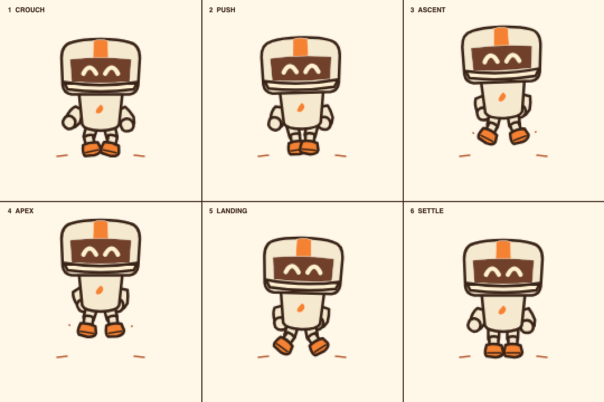

# Iteration 13 — Paint hop study

## Proposal

A code-native, classic Paint-style study uses one fixed Sower template through six proposed beats: crouch, push, ascent, apex, landing, and settle. The broadened cream rounded-square protective hood, high cocoa face window, broad pale arch eyes, orange crown stripe and boots, single orange seed chest mark, compact torso, and attached mittens carry the Goat 4 preference direction and balanced iteration-12 family.

`drawSower(ctx, pose)` draws the same head, torso, limb, and face paths every time. Pose records change root translation/rotation and arm, hip, and knee rotations; no character shape is scaled or redrawn per pose. Each frame renders to a half-resolution offscreen canvas and upscales with smoothing off for stepped edges. Mars rust marks stay on the scene ground. There is no paper grain, gradient, gloss, or texture treatment.

The timing proposal holds each key pose for **320 ms**, for a **1.92-second six-beat cycle**. This is a discrete storyboard timing suggestion, not source animation or production timing. Play/pause and a six-position scrub control are included. Reduced-motion preference opens on a paused crouch.

## Exports and live study

- Interactive page: [Paint hop study](../../../public/sowers/prototypes/paint-hop/index.html)
- Six-pose sheet: [iteration-13-paint-hop-sheet.png](../../../public/sowers/prototypes/iteration-13-paint-hop-sheet.png)
- Neutral pose: [iteration-13-paint-hop-neutral.png](../../../public/sowers/prototypes/iteration-13-paint-hop-neutral.png)

The exported images were downloaded from the page’s Canvas 2D PNG controls, which call the same renderer and pose data used by the interactive view.

## Checks and limits

- The six live slider positions were inspected in order; each has a distinct pose label and joint configuration. The widened hood, shortened torso, fully framed apex, and grounded neutral feet are visible in the final exports.
- Fixed path data and the absence of scaling in `drawSower` preserve head and torso geometry and limb volume across poses.
- Play/pause toggles; scrubbing pauses playback. The frame callback exits without scheduling another frame while paused. Reduced-motion behavior is selected from `prefers-reduced-motion` at load.
- The stylesheet fits the stage to the viewport width and wraps controls below 520 px. Mobile fit was checked from the responsive CSS rules; no device-emulation capture was made.
- `node --check sowers/prototype-paint-hop/main.js` passed. The final public renderer was played and scrubbed through all six poses without a render failure.
- This proposal does not establish final character proportions, source animation, exact production timing, physical dimensions, or manufacturing behavior.

## Provenance pins

The machine-readable record in [iteration-13-paint-hop.json](iteration-13-paint-hop.json) pins the source files, public copies, PNG exports, and inspected references by SHA-256.

Coordinator browser follow-up: both public/source routes traversed six poses, paused scrubbing stayed stable,390px had no overflow, reduced-motion startup was emulated, and no page errors were observed. Neutral export has exact2×2 pixel blocks throughout. The1.92s cycle is nominal, not a timing guarantee under delayed frames.
