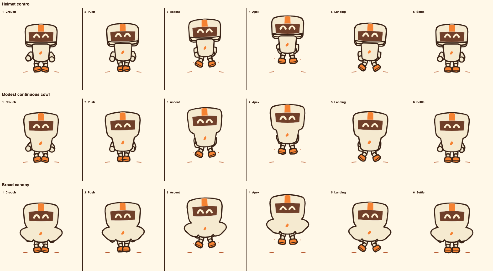

# Iteration 14 — Canopy hop comparison

## Study

A code-native comparison based on the Iteration 13 Paint hop renderer. It keeps the same six pose records, 320 ms proposed hold, palette, face, seed, mittens, legs, boots, ground marks, and 360×360 render envelope. Each variant has a fixed head and upper-body contour; poses change root translation/rotation and existing arm, hip, and knee rotations only.

- **Helmet control:** the prior separate hood, compact torso, and protective lip.
- **Modest continuous cowl:** one modest hood-to-shoulder outline, with the separate collar bar removed and the torso and attached mitten tabs still readable.
- **Broad canopy:** a wider shoulder flare that owns the outer silhouette.

The face window and crown stripe shift together slightly in the cowl treatments to stay within the taller contour. Cream, orange, and cocoa fills use the original Paint palette; eyes retain the friendly arches and the chest keeps the original seed mark. The shapes use hard outlines and half-resolution pixels enlarged with smoothing disabled. No gradients, texture, gear, straps, or antenna are used. This is an authored contour comparison, not a measured preference test.

## Interactive study and exports

- [Interactive Canopy Hop study](../../../public/sowers/prototypes/canopy-hop/index.html)
- [Three-variant neutral comparison](../../../public/sowers/prototypes/iteration-14-canopy-hop-neutral-comparison.png)
- [18-pose contact sheet](../../../public/sowers/prototypes/iteration-14-canopy-hop-18-pose-sheet.png)

The comparison export is 1080×420 PNG; the contact sheet is 2160×1188 PNG. Both exports call the same `drawFrame` and `drawSower` functions as the interactive view, render all six shared pose records, and label each variant/pose.

## Observations

- The control preserves the distinct helmet lip over a narrow torso.
- The modest cowl makes the largest change at the jaw/shoulder transition while preserving an identifiable torso, seed, and attached hands.
- The broad canopy reads most strongly as a connected shoulder shell. Its broad lower edge partly occludes arms and mitten cues, especially in crouch, push and settle.
- All three contours retain the broad rounded head, face arches, orange crown stripe, seed mark, and boot split from the Goat 4 preference direction. The sheet is a comparison aid; it does not establish final proportions or production animation.

## Verification

- `node --check sowers/prototype-canopy-hop/main.js` passed.
- Chromium loaded the public route and rendered 18 combinations; all 18 Canvas images differed as expected. No page errors were observed.
- Play/pause advanced through poses. Paused frames remained pixel-identical over a 500 ms interval; reduced-motion emulation opened on Settle with Play shown, and the paused frame remained stable.
- At 390 px viewport width, the document had no horizontal overflow (390 px document/client width; stage 358 px).
- The full contact sheet was visually inspected: all six poses for each contour fit within their cells, with the neutral feet aligned to the ground marks.
- The three public portable files match their source counterparts byte-for-byte.

## Provenance

The source/public file hashes, export dimensions and hashes, and the preference/reference hashes are pinned in [iteration-14-canopy-hop.json](iteration-14-canopy-hop.json). The Goat 4 reference is recorded as a preference anchor; Iteration 11 MB and Iteration 13 Paint assets are contextual comparisons only.

Campfire qualification: the broad canopy produces the strongest shoulder outline, but partly occludes arm/mitten gestures; the scalloped lower edge can read as a skirt or flower. The modest cowl preserves more torso/hand readability. These are synthetic design observations, not audience preference findings.
