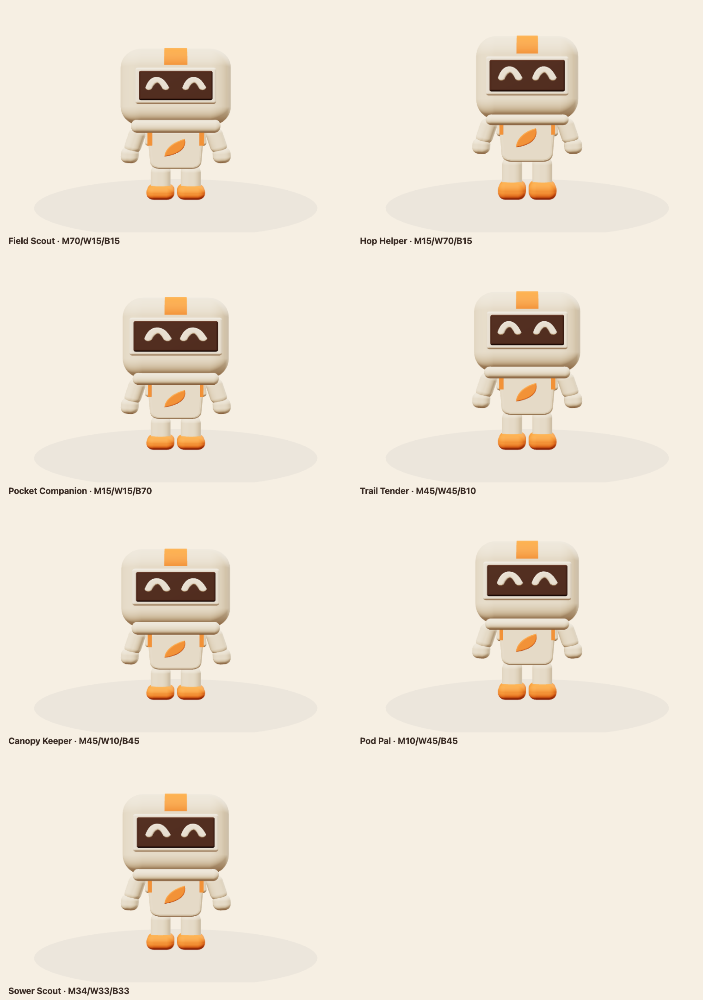

# Iteration 14 — Procedural 3D mixture study

**Scope:** isolated Three.js study copied from the accepted iteration 13 articulated rig. Mixture numbers are authored design weights used to interpolate geometry parameters. They are not measured style ownership, source attribution, or a learned classifier.

## Interactive study

Open [the procedural mixture viewer](../../../sowers/prototype-mix/index.html). Mars Mission, Wobbly Life, and Bot Crossing controls keep the total at 100%; each slider has an associated accessible label. The seven reviewed recipes are available as presets. Recipe changes rebuild the Three.js rig so the visible geometry responds to the parameter interpolation.

The fixed warm cream, citrus orange, and cocoa palette, broad pale arch eyes, seed chest mark, and orange crown stripe carry through each recipe. The authored M endpoint uses a broader, shorter hood, narrower face opening and thicker cowl; W uses a taller hood, longer limbs and moderate face; B uses the friendliest broad face and compact body. Orange flank flashes are modest and strongest toward M. Neutral, reach, and hop controls keep one rig's proportions fixed while posing.

## Same-camera recipe captures

All seven recipe cells use the same front camera and neutral pose. Framing is shared; mobile layout adapts around one common viewer envelope rather than normalizing each recipe's height. The image is a browser WebGL canvas capture of the actual geometry. It documents this blockout's appearance only; it does not prove mesh intersections, audience preference, market fit, production readiness, material behavior, or candy performance. Silhouette differences remain intentionally controlled and subtle relative to the original 13 rig.

## Geometry and motion checks

A 10-point ternary lattice sampled 66 integer mixtures and neutral, reach, and hop at progress 0, 0.5, and 1 (594 samples). Every world matrix was finite; geometry identities and part scales were stable within each rig across poses. Neutral and reach rested on y=0 within 0.000000005 units. Torso/leg and leg/boot bounds remained connected under the coarse bounding-box check. These bounds do not prove exact mesh intersections. The crown stripe stayed within the head bounds at the M/W/B endpoints; the lower cowl and face aperture use stable mesh names. Only the named face rim, cocoa window, and eye arches receive the face aperture factor. Measured endpoint hood widths match 2.16 / 1.88 / 2.02; face-to-hood width ratios are 0.578 / 0.698 / 0.798 against authored 0.58 / 0.70 / 0.80. Two flank accent meshes are always present with continuously interpolated widths (0.098 / 0.064 / 0.052 at M/W/B endpoints). Each rebuilt rig reports its actual 21 unique geometries, including accents, and recipe rebuild disposes the previous rig geometries. The viewer starts paused, paints on resize and control changes, honors reduced-motion by disabling playback, and keeps at most one scheduled animation frame. Pressing Play explicitly selects Hop in both the pose control and rig; Pause cancels the outstanding frame.

## Provenance pins

Preference anchors reviewed: private `goat4.png` SHA-256 `2da2122677cdbb1a494cbf99cbd89312f8bb38761fcdd1f5fe315278b228bfa7` and iteration 12 balanced concept SHA-256 `f6eb5d63bbba7b50c8bc49647e438f9a1a52d1a9a8bad29c9c1cb42c3b70c6b3`. Iteration 13 neutral-front and neutral-three-quarter browser captures are pinned in the companion JSON. Corpus evidence remains reference-only, with no claims about unobserved source geometry or motion.
