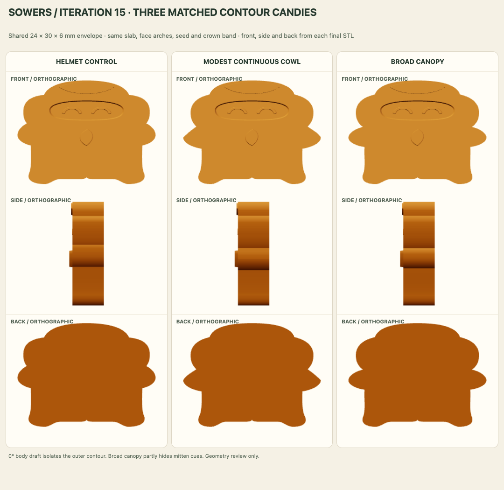

# Iteration 15 — Contour candy comparison

## Study

Three positive single-color solids carry the Iteration 14 helmet-control, modest-cowl and broad-canopy directions into a matched geometry comparison. Every part shares a 24 × 30 × 6 mm envelope, flat back, constant slab profile, 0° nominal body draft, face recess, two raised happy arches, seed relief and one common crown-band relief. The 0° wall is intentional: it isolates silhouette and does not demonstrate release.

The head-to-shoulder contours are authored interpretations of the published Iteration 14 vector-art comparison. They were re-authored as sampled curves and normalized into the shared design envelope; they are not pixel-exact conversions. The face and relief use the same authored construction in all three parts. A broad curved band reaches toward the crown boundary and replaces the rounded badge/pill treatment from Iteration 14. There are no folded overhangs.

## Measurements

Every exported STL was reopened and its volume recomputed. All three have finite vertices, a single connected component, watertight topology, two incident faces per edge, consistent winding, Euler number 2, positive volume and the target bounds.

| Contour | Bounds (mm) | Recomputed volume (mm³) | Vertices / faces | SHA-256 |
|---|---:|---:|---:|---|
| Helmet control | 24 × 30 × 6 | 3060.326 | 1,396 / 2,788 | `eb49acc83ce4fe342852a66851200b31439c4dcc628e53e172782f4c57176154` |
| Modest continuous cowl | 24 × 30 × 6 | 2928.645 | 1,396 / 2,788 | `7922dc3e08463f4668f12de5fb3f0d208274633f85f59f5d34a01b11feca9165` |
| Broad canopy | 24 × 30 × 6 | 2961.530 | 1,396 / 2,788 | `55389f476feb25c5458135d3acdc60c87a6aeb4c03976ff915c43e36a3c6c45a` |

The comparison sheet renders front, side and back orthographic views from each exact final STL with the same camera positions, warm-cream opaque background and labels. The interactive viewer at `/sowers/prototype-contour-candies/` loads the same files; its default is static, it fits responsively, offers an optional flat inspection, and ignores stale mesh-load responses after a selection changes.

## Readout and limits

- The broad canopy creates the widest continuous shoulder flare, but its connected shell obscures mitten cues. That is a design weakness for the single-color candy form, not a hidden limb detail.
- The inspected Goat 4 favorite has a distinct broad rounded-square helmet rim, crown band, horizontal cocoa face window with happy arches, central seed, visible side mittens and shallow boot notch. The helmet control carries the clearest rim; the broad canopy loses mitten cues and therefore departs from a feature visible in the favorite.
- The helmet control has a separate shoulder/arm interruption below the rounded helmet. The modest cowl joins the hood into a narrower shoulder line.
- Hands and feet remain thick, joined into the positive outline, and the foot split is a shallow central notch.
- These are geometry-review positives only. No mold-release, material, food-contact, supplier, tolerance, shrink, tooling or manufacturing proof was performed. The sampled curves and straight slab walls do not establish production suitability.

## Artifacts and provenance

- Generator: [`tools/sowers-contour-candies.py`](../../../tools/sowers-contour-candies.py)
- Actual STL exports, machine-readable measurements, and the comparison PNG: [`public/sowers/prototypes/contour-candies/`](../../../public/sowers/prototypes/contour-candies/)
- Interactive viewer: [`sowers/prototype-contour-candies/`](../../../sowers/prototype-contour-candies/)
- Complete dimensions, per-STL validation, SHA-256 values, render method and source pins: [`iteration-15-contour-candies.json`](iteration-15-contour-candies.json)

The original Sowers-repository lookup did not find `goat4.png`; it was subsequently located and inspected at `/Users/martinburstein/Downloads/goat4.png`. Its SHA-256 is `2da2122677cdbb1a494cbf99cbd89312f8bb38761fcdd1f5fe315278b228bfa7` and is included in the JSON source pins alongside the preference-anchor note and Iteration 14 comparison artwork.

Coordinator independently verified all three final meshes: finite, watertight, consistently wound, positive volume, edge incidence2, connected face graph, Euler2, exact24×30×6mm bounds, volume/report and SHA agreement. The contours are authored controls, not faithful replicas of the rendered characters; torso/head proportions are still coarse. Crown-band and mitten readability remain open design questions.
