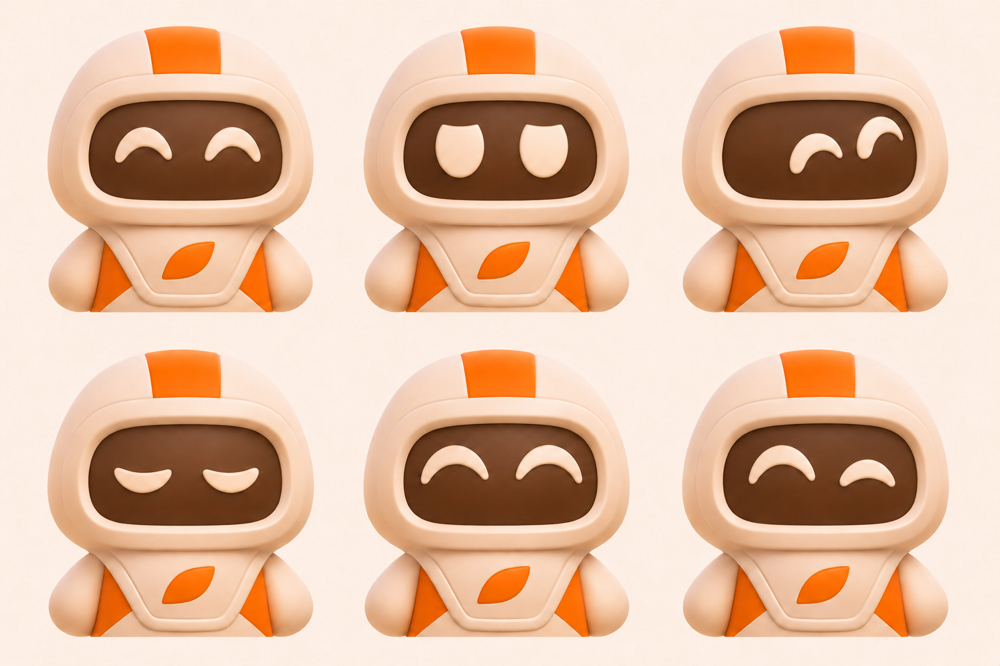

# Iteration 15 — Scout expressions

**Recipe:** M34/W33/B33, inherited from balanced Scout iteration 12. These are authored art-direction weights, not measurements or style attribution. Labels are proposed visual states, not inferred real agent activity and not audience-tested recognition.

## Reading order and review

1. Content/default happy arches — reads clearly as the friendly default.
2. Calmly focused — broad upright pale eyes make this visibly distinct from waiting, though the large oval eyes read slightly more alert than half-lidded.
3. Curious/directional gaze — the eyes are asymmetric and one is raised, but they do not clearly indicate a shared directional gaze. This remains ambiguous with seeking attention.
4. Patient waiting — matching relaxed downward eye arcs; distinct from focused.
5. Pleased/celebrating — expansive happy arches. This is close to the default but broader and more open; the distinction is mild.
6. Gently seeking attention — one larger and one smaller forward-facing arch. This remains ambiguous with curious despite the different intended treatment.

Across the sheet, the same rounded protective hood, stripe, cocoa face window, torso crop, seed mark, material, lighting and framing are retained. Large eye shapes make the states readable at this scale. The curious/seeking pair is not fully resolved; no recognition pass is claimed.

## Generation record

- Tool mode: built-in `image_gen__imagegen`; one original raster generation and one targeted repair. No CLI or API key.
- Reference roles: Goat 4 (`/Users/martinburstein/Downloads/goat4.png`) supplied preferred palette, finish and helper personality; iteration 12 (`public/sowers/prototypes/iteration-12-balanced.png`) supplied Scout identity and proportions; iteration 14 (`public/sowers/prototypes/iteration-14-family-lineup.png`) supported identity continuity. Repair input was the first generated six-cell sheet.
- Output: [iteration-15-scout-expressions.png](../../../public/sowers/prototypes/iteration-15-scout-expressions.png), 1536 × 1024 PNG.
- SHA-256: `877725d1c2c061a4cd8b33d513c0a5bd1f23afe6727a55398ccf3a9aad7978e8`.
- Exact prompts, reference roles and output metadata are in [iteration-15-scout-expressions.json](iteration-15-scout-expressions.json).

This is a proposed visual expression study. It does not represent actual agent activity or establish audience recognition.
