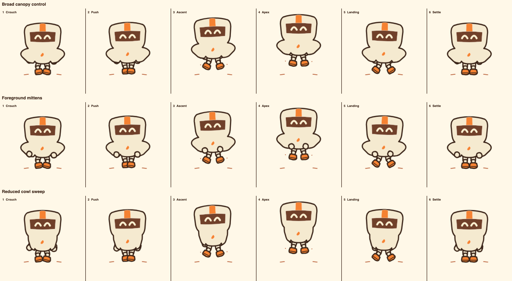

# Iteration 16 — Canopy hands comparison

## Study

A code-native 2D comparison forked from the Iteration 14 Canvas renderer. The same fixed head, torso and face, seed, warm palette, six pose records, joint transforms, 320 ms timing proposal and 360×360 envelope are used in every variant. Only the cowl sweep and mitten draw order change.

- **Broad canopy control:** broad fixed shoulder shell; attached rotating arms and mittens draw behind the shell.
- **Foreground mittens:** the same shell and arm geometry; the same mitten shapes are redrawn at their arm endpoints above the shell so they stay visibly attached.
- **Reduced cowl sweep:** a fixed, smooth, narrower lower shell; original hand-behind-shell order.

The canvas uses flat Classic Paint fills and 180×180 drawing enlarged 2× with smoothing disabled. Variant and pose selection use native keyboard-operable controls. The view defaults to paused on Settle. Playback uses one cancellable loop; reduced-motion preference keeps the view static and disables Play.

## Interactive study and exports

- [Interactive Canopy Hands study](../../../public/sowers/prototypes/canopy-hands/index.html)
- [Three-variant neutral comparison](../../../public/sowers/prototypes/iteration-16-canopy-hands-neutral-comparison.png)
- [18-pose contact sheet](../../../public/sowers/prototypes/iteration-16-canopy-hands-18-pose-sheet.png)

Both exports use the same `drawFrame` / `drawSower` renderer as the interactive study. Dimensions, hashes and source pins are recorded in [iteration-16-canopy-hands.json](iteration-16-canopy-hands.json).

## Observations

- In the broad control, the shell partly hides the hand cues at neutral and through the work poses.
- Foreground layering exposes the compact mitten ends. Their placement follows each rotating arm's shoulder joint, so they remain attached in the 2D pose drawing.
- The reduced sweep gives the shell a narrower lower outline and removes the broad scalloped edge that can read as a skirt or flower.
- All three keep the same face, crown stripe, seed, palette, pose data, timing and fixed character volume.

This is an authored visual comparison, not a measured preference test. Foreground mitten layering is a 2D study, not proof of 3D garment/hand intersection or candy moldability. It does not establish production animation, physical dimensions or manufacturing behavior.

## Verification

- `node --check sowers/prototype-canopy-hands/main.js` passed.
- The public route rendered 18 distinct variant/pose combinations with no page errors. Paused frames stayed pixel-identical over 500 ms.
- Reduced-motion emulation opened on Settle with playback disabled. At 390 px viewport width, the document had no horizontal overflow (390 px document/client width; 358 px stage).
- Both exports were visually inspected; each label and all 18 poses fit inside their image bounds.
- The public portable files match the source counterparts byte-for-byte.

The Goat 4 reference is a preference anchor, not independent market evidence. The full reference roles, source/public hashes, export hashes and dimensions are pinned in the paired JSON record.
